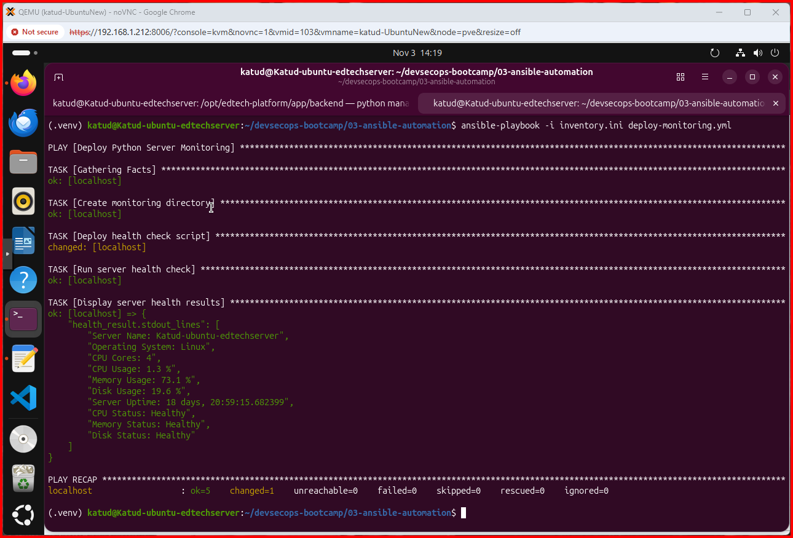

# Ansible Server Monitoring — Deployment and Troubleshooting

**Date:** November 3, 2026  
**Environment:** Ubuntu VM on Proxmox; Ansible controller and managed host: `localhost`  
**Project:** `devsecops-bootcamp/03-ansible-automation`

## Objective
Automate deployment and execution of the Python `health_check.py` script using Ansible, and display the resulting CPU, memory, disk, and uptime metrics.

## Files and layout
- `03-ansible-automation/inventory.ini` — inventory group `devops_servers` targeting localhost.
- `03-ansible-automation/deploy-monitoring.yml` — deployment playbook.
- `02-python-automation/server-monitoring/health_check.py` — source script.
- `/home/katud/server-monitoring/health_check.py` — deployed copy.

## Deployment procedure
From the `03-ansible-automation` directory:

```bash
# Validate YAML and Ansible playbook syntax without deploying.
ansible-playbook -i inventory.ini deploy-monitoring.yml --syntax-check

# Deploy the script and execute the server health check.
ansible-playbook -i inventory.ini deploy-monitoring.yml
```

The playbook gathers facts, creates `/home/katud/server-monitoring`, copies the Python script, runs it with the project's Python virtual environment, and prints its output. The observed run targeted `localhost`; it did not deploy to a separate remote server.

## Troubleshooting: source file not found

**Symptom:** The task **Deploy health check script** failed with `Could not find or access .../health_check.py on the Ansible Controller`.

**Root cause:** A naming mismatch involving `authomation` versus `automation` in the bootcamp directory names and references. The playbook's `src` path did not resolve to the actual script. Earlier attempts also used a relative path from the Ansible directory and a mismatched absolute path.

**Diagnosis:**

```bash
# Inspect sibling module directories for naming inconsistencies.
ls -la ~/devsecops-bootcamp/

# Locate the actual script, regardless of the containing directory name.
find ~/devsecops-bootcamp -type f -name 'health_check.py'

# Confirm the source file exists and can be read.
ls -l ~/devsecops-bootcamp/02-python-automation/server-monitoring/health_check.py

# Show the source reference currently stored in the playbook.
grep 'src:' deploy-monitoring.yml
```

**Resolution:** Corrected the directory names to `02-python-automation` and `03-ansible-automation`, aligned the `src` reference in `deploy-monitoring.yml` with the real script location, and reran the playbook. In Ansible, `copy.src` must reference a file accessible on the controller.

**Verification:** The final run completed with `ok=5`, `changed=1`, `unreachable=0`, and `failed=0`.

## Observed health-check results
| Metric | Observed value |
| --- | --- |
| Host | Katud-ubuntu-edtechserver |
| Operating system | Linux |
| CPU cores | 4 |
| CPU usage | 1.3% |
| Memory usage | 73.1% |
| Disk usage | 19.6% |
| Uptime | 18 days, 20:59:15 (approximately) |
| CPU / memory / disk status | Healthy / Healthy / Healthy |

These are point-in-time measurements from the successful run, not ongoing monitoring guarantees.

## Screenshot evidence
**Figure 1 — Successful Ansible monitoring deployment.** The terminal shows the five successful tasks, health metrics, and play recap with zero failures.



**Earlier failure screenshot:** The failed-run output was reviewed during troubleshooting; a copy is not included in this package. Add it as `screenshots/02-ansible-source-file-error.png` if you want to preserve visual evidence of the error.

## Lessons learned
1. Confirm directory names exactly; a single extra character can break automation.
2. Use `find`, `ls`, and `grep` to validate paths rather than repeatedly guessing.
3. Run `--syntax-check` first, but remember syntax checks cannot prove that source files exist.
4. Confirm success from the play recap and actual application output.
5. Preserve failure details and screenshots alongside successful results for reproducible troubleshooting.
