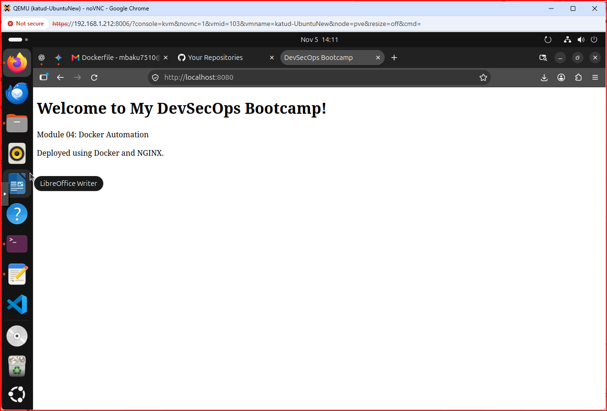
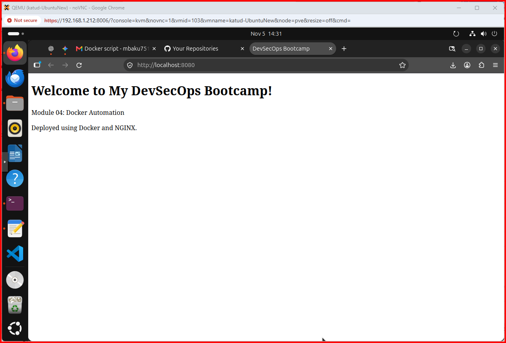
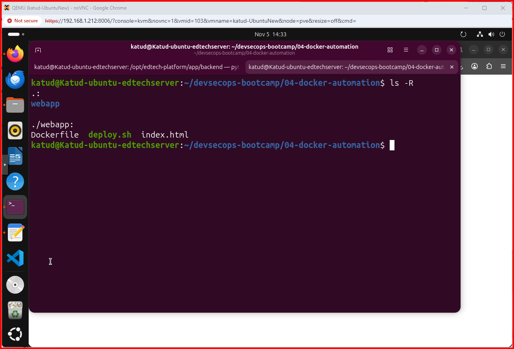
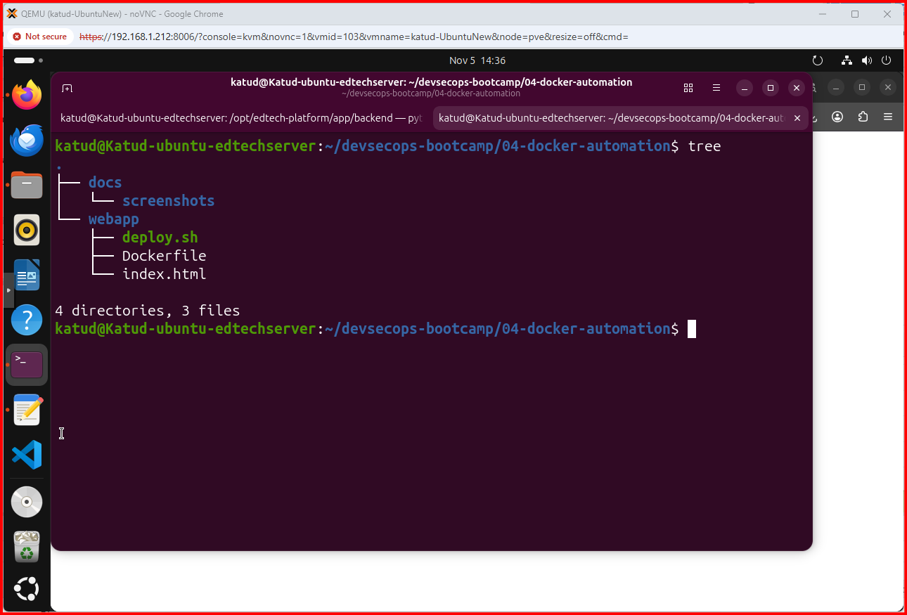
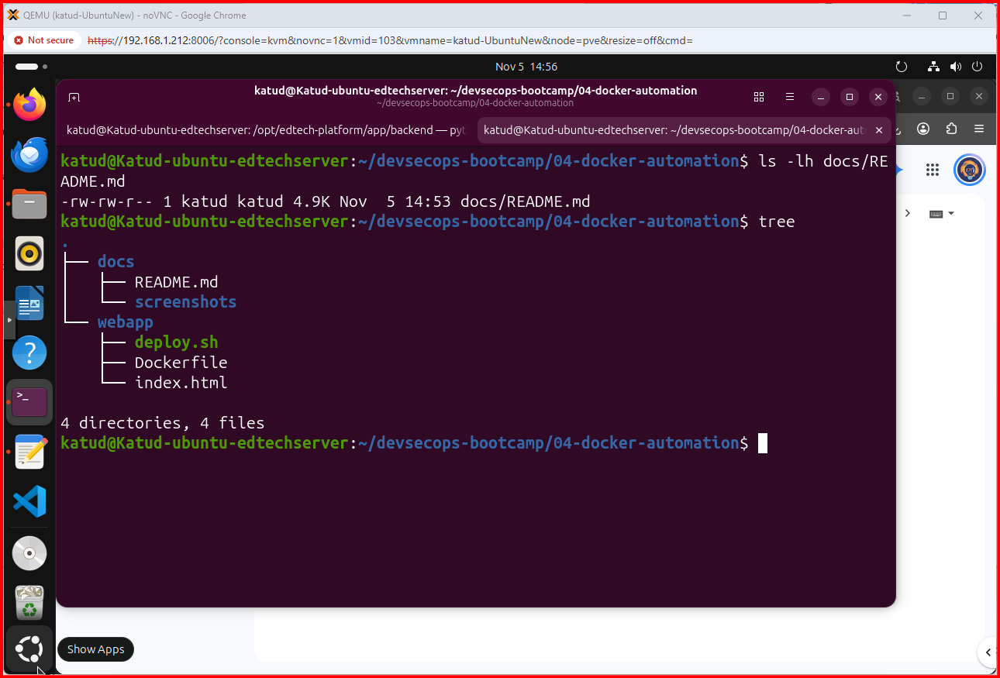

Module 04 — Docker Automation

Project: DevSecOps Hands-On Bootcamp
Date: November 5, 2026
Environment: Ubuntu VM hosted on Proxmox
Technologies: Docker, NGINX, Bash, Linux, Git, GitHub
1. Project Objective

The objective of this module is to containerize a custom HTML application using Docker and NGINX and automate its deployment with a Bash script.

The deployment automation performs five operations:

    Builds a Docker image.

    Removes the previous application container.

    Starts a new container.

    Verifies the container status.

    Tests the application endpoint.

2. Project Structure

04-docker-automation/
├── webapp/
│   ├── Dockerfile
│   ├── deploy.sh
│   └── index.html
└── docs/
    ├── README.md
    └── screenshots/

3. Docker Installation Verification

Before beginning deployment, Docker was verified on the Ubuntu VM.

# Check Docker installation and server information
docker info

# List running containers
docker ps

# List all containers, including stopped containers
docker ps -a

Result: Docker Engine was running successfully.
4. Creating the Web Application

A custom HTML webpage was created in:

webapp/index.html

The webpage displays:

    Welcome to My DevSecOps Bootcamp!

    Module 04: Docker Automation

    Deployed using Docker and NGINX.

5. Creating the Dockerfile

The Dockerfile uses the official NGINX Alpine image.

# Use the lightweight NGINX Alpine image
FROM nginx:alpine

# Copy the custom webpage into the NGINX web directory
COPY index.html /usr/share/nginx/html/index.html

# Document the HTTP port
EXPOSE 80

6. Building the Docker Image

# Navigate to the application directory
cd ~/devsecops-bootcamp/04-docker-automation/webapp

# Build the Docker image using the current directory
docker build -t devsecops-webapp:v1 .

# Verify the image exists
docker images

Result: The image devsecops-webapp:v1 was built successfully.
7. Running the Application Container

# Start the custom application container
docker run -d \
  --name devsecops-webapp \
  -p 8080:80 \
  devsecops-webapp:v1

# Verify the container is running
docker ps

# Test the application endpoint
curl http://localhost:8080

Result: The container started successfully and returned the custom HTML webpage.
8. Automating Docker Deployment

A Bash deployment script was created:

webapp/deploy.sh

The script automates image building, container replacement, deployment verification, and HTTP testing.

# Make the deployment script executable
chmod +x deploy.sh

# Execute the automated deployment
./deploy.sh

Result:

Deployment completed successfully!

9. Application Verification

The deployed application was verified using both the terminal and Firefox.

# Verify the running container
docker ps

# Check the HTTP response
curl -I http://localhost:8080

Expected HTTP response:

HTTP/1.1 200 OK

The webpage was also successfully displayed in Firefox at http://localhost:8080.
10. Troubleshooting and Solutions
Issue 1: Docker Build Failed

Error:

docker: 'docker build' requires 1 argument

Cause: The Docker build command was missing the build context.

Solution:

# The period specifies the current directory as the build context
docker build -t devsecops-webapp:v1 .

Result: Docker successfully built the application image.
Issue 2: Connection Refused on Port 8080

Error:

curl: (7) Failed to connect to localhost port 8080

Cause: The previous NGINX container had been removed, and no replacement container was running.

Solution:

# Start the custom application container
docker run -d \
  --name devsecops-webapp \
  -p 8080:80 \
  devsecops-webapp:v1

Result: The application became accessible on port 8080.
Issue 3: Removing an Unnecessary Docker Image

The original nginx:latest image was no longer required.

# Remove the old container
docker rm -f bootcamp-nginx

# Remove the unused NGINX image
docker rmi nginx:latest

# Verify the remaining images
docker images

Result: The unused image was removed while the custom application image was retained.
11. Deployment Evidence

The following screenshots document the deployment process.
Screenshot 1 — Docker Image Build

Screenshot 2 — Running Docker Container

Screenshot 3 — Automated Deployment

Screenshot 4 — Browser Verification

12. Skills Demonstrated

    Docker image creation

    Container lifecycle management

    Dockerfile configuration

    Linux shell scripting

    Automated application deployment

    HTTP endpoint verification

    Troubleshooting container connectivity

    Technical documentation

13. Conclusion

Module 04 successfully demonstrated how Docker and Bash scripting can automate application deployment.

The custom NGINX application was containerized, deployed, tested, and verified through a web browser.

The deployment process can now be repeated using a single Bash script.

Status: Completed Successfully

## Deployment Evidence

### 1. Web Application

### 2. Successful Deployment

### 3. Deployment Automation Script

### 4. Project Directory Structure

### 5. README Documentation

