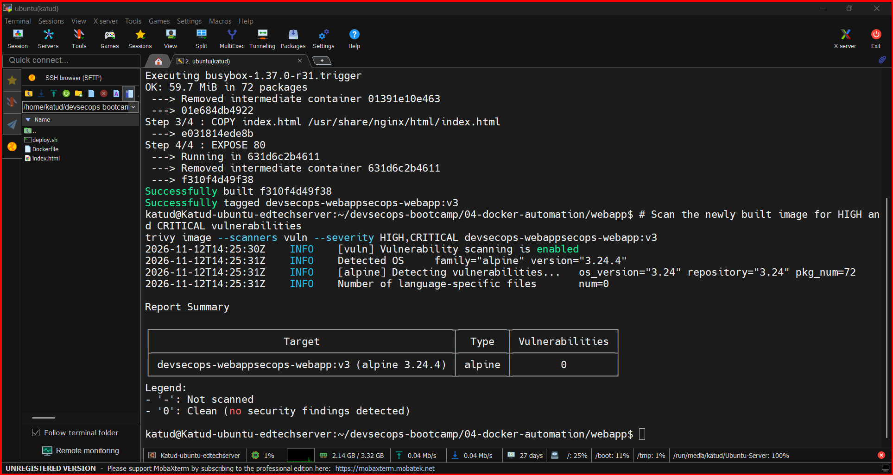
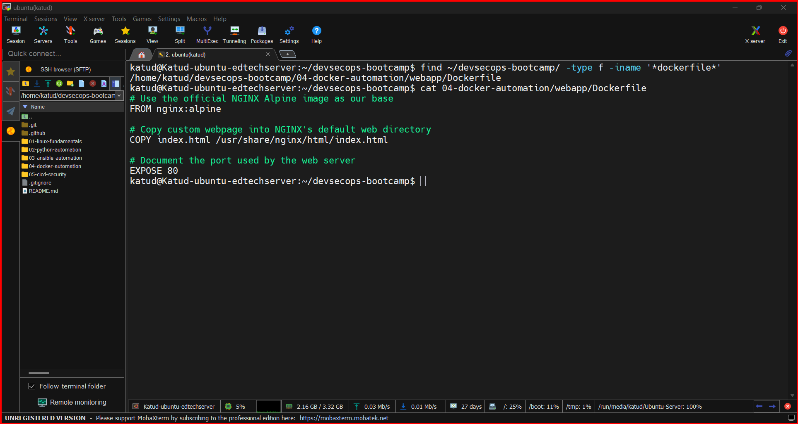
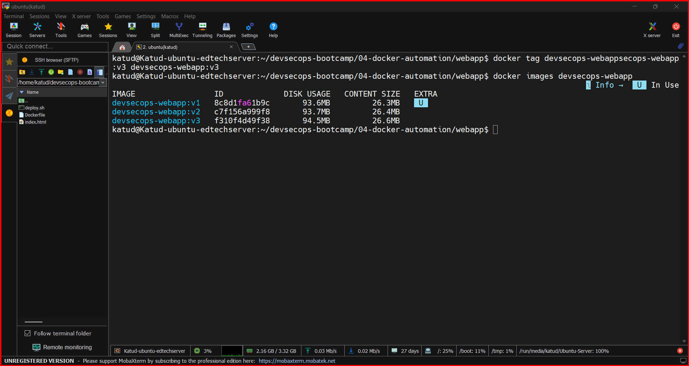
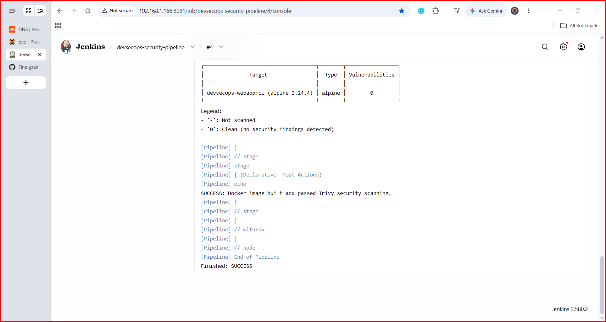

# Jenkins + Trivy CI Security Gate — Evidence

## Outcome
Jenkins job `devsecops-security-pipeline`, build **#4**, completed with **SUCCESS**. The `devsecops-webapp:ci` image returned **0 HIGH and 0 CRITICAL** vulnerabilities in the Trivy scan.

## Remediation record
The earlier image `devsecops-webapp:v2` reported three HIGH findings against `libxslt` (CVE-2026-125350, CVE-2026-87636, CVE-2026-9947), with installed version `1.1.43-r3` and available fix `1.1.43-r4`. The Dockerfile was updated to run `apk upgrade --no-cache` during the build. The build output showed `libxslt` and `zlib` updates. The updated Dockerfile was committed and pushed to the repository before rerunning Jenkins.

## Pipeline stages
1. Checkout source from GitHub.
2. Check build environment and installed tools.
3. Build `devsecops-webapp:ci` from `04-docker-automation/webapp`.
4. Scan the newly built image using Trivy with `--severity HIGH,CRITICAL --exit-code 1 --scanners vuln`.

## Screenshots

### Initial findings

### Patched Dockerfile

### Clean scan of patched image

### Successful Jenkins build #4

## Security note
A clean HIGH/CRITICAL vulnerability scan is not a guarantee of complete image security. Rebuild and rescan regularly as vulnerability databases and base images change.
